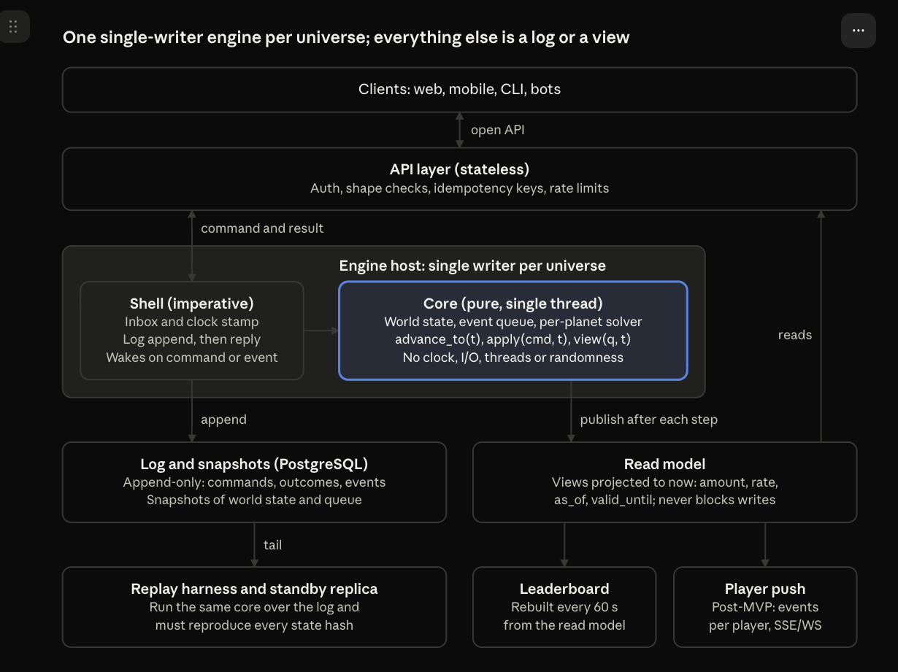
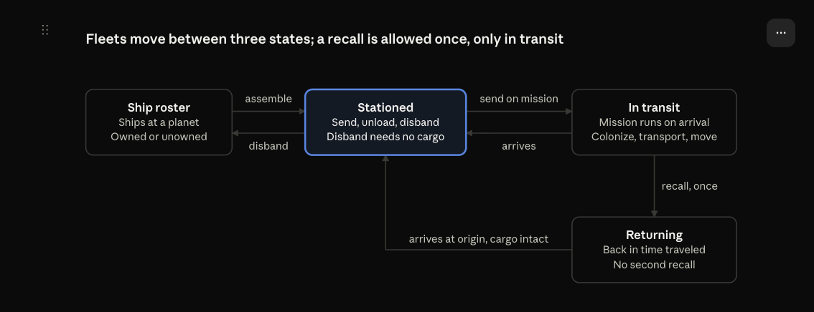

# Voidforge Architectural Design

Oct 1, 2026 · @Tomáš Grbálik

## Overview

The Voidforge server is a deterministic discrete-event simulation. One in-memory engine per universe moves game time from event to event, never by fixed ticks. Every state can be rebuilt exactly from a log of timestamped commands.

This document specifies the server for the MVP rules in Voidforge MVP Game Design: planets, resources, buildings, fleets, scoring and the ten player actions. Clients, the auth provider and post-MVP mechanics are out of scope. The design leaves room for combat randomness and sharding later.

Goals:

- Implement the game design's event-driven, lazy-calculation engine exactly, including cascades and races.
- Make every run reproducible, because replays, tests, crash recovery and standby replicas all depend on it.
- Keep the core small and framework-free, so AI coding agents can build it against tests and lint rules.

Non-goals:

- Replaying a log under a different rules version or engine build; replays are pinned to both.
- Splitting one universe across machines in the MVP.
- Tying the design to a language or framework; nothing here assumes C#, Rust or a library.

Determinism, as used throughout: given an initial world snapshot, a rules version and an ordered list of commands with their game times, the engine produces byte-identical state and the same sequence of domain events.

## Architecture at a glance

Commands and reads take separate paths. A command goes from the API layer into the engine host, into the log, and back as a reply; reads come from a read model the host publishes after every step.

Nothing but the engine host ever changes game state.



The diagram places idempotency keys in the API layer for brevity; the engine host owns the key-to-outcome map, as Engine host and write path specifies.

The shell is the only part that touches the clock, the network or the database. The core it calls is pure, which is what makes replays exact.

The core is specified in Engine core and Per-planet solver, the shell in Engine host and write path, the log in Persistence, and the read model in Read side and API.

## Time model

Game time advances by events, not ticks. Between two events every quantity changes at a constant rate, so the engine can compute any value at any instant and the exact time of the next threshold.

Each continuous quantity is stored as a checkpoint: a value, a rate and the time they were taken. Reading it at time t costs one multiplication and one addition.

```latex
v(t) = v_{cp} + r \cdot (t - t_{cp})
```

Where:

- v(t): the quantity's value at game time t
- v\_cp: its value at the last checkpoint
- t\_cp: the game time of that checkpoint
- r: its rate of change, constant until the next event

Rates change only at events, and there are two kinds:

- Timers, known when they are created: fleet arrival, recall return, demolition end.
- Threshold crossings, computed from current rates: a stock reaching 0 or its cap, a build's delivered ingots reaching its cost.

A crossing time follows directly from the checkpoint, for a boundary B:

```latex
t_{cross} = t_{cp} + \frac{B - v_{cp}}{r}
```

Where:

- t\_cross: the game time at which the quantity reaches B
- B: the boundary it is moving toward: 0, a storage cap, or a build's ingot cost
- v\_cp, t\_cp and r: as above, with r nonzero and pointing toward B

Ticks would add cost without adding precision. Ore storage with 1,000 t of free space, filling at 2 t/h, is one scheduled event at hour 500; a one-second tick would touch that planet 1.8 million times. Coarse ticks are cheaper but blur which fleet arrived first.

Ticks also add nothing to determinism, which comes from the rules in Determinism rules. The only fixed-interval jobs in this design are derived ones: the leaderboard rebuild and snapshots.

Game time is a signed 64-bit count of milliseconds since the universe epoch. It is an input to the engine: the shell stamps every command, and the core never reads a clock.

## State model

The engine keeps the whole universe in memory as one `World` value. Entities refer to each other by integer ID, never by pointer, and every collection iterates in ID order.

Memory is only the working copy. PostgreSQL holds the durable state: an append-only log of every command plus periodic snapshots, and a restart rebuilds the `World` from the newest snapshot and the log after it (see Persistence).

| Entity | Key fields | Notes |
| --- | --- | --- |
| World | `time`, `rules_version`, `next_id`, entity maps, event queue | One per universe; the unit of a snapshot |
| Player | `id`, `homeworld_id` | Created by Join game; its id is a UUIDv7 chosen outside the core and logged with the command |
| Planet | `id`, coordinates, `owner`, `slots`, storage caps, ore and ingot stocks, buildings, shipyard queues, roster, `version` | `version` increases on every re-solve |
| Building | `id`, planet\_id, `type`, state: under construction (delivered, cost), operational, or demolishing (ends at) | Slots are identical, so there is no slot index |
| Ship build | `id`, `shipyard_id, ship_type`, delivered, cost, active or waiting | At most 3 active per Shipyard; waiting builds consume nothing |
| Ship | `id`, `type`, `owner`, location: a planet's roster or a fleet | Several players' ships can share an unowned planet's roster |
| Fleet | `id`, `owner`, ship IDs, cargo per resource, `version`, state: stationed, in transit or returning | Speed and capacity derive from its ships |

All numbers are integers; floats never appear in the core.

| Quantity | Unit | Storage |
| --- | --- | --- |
| Game time | millisecond | 64-bit signed |
| Mass: stocks, cargo, delivered ingots | gram (1 t = 1,000,000 g) | 64-bit signed |
| Mass rate | gram per hour | 64-bit signed |
| Coordinates and speed | fixed-point distance units | 64-bit signed |
| Products inside formulas | same as operands | 128-bit signed |

A continuous quantity stores its value, rate, rounding remainder and checkpoint time. The remainder makes one long interval and many short ones give the same result (see Determinism rules).

Rules are data in one versioned table: `BuildingSpecs`, `ShipSpecs`, `ScoringSpecs`, the homeworld template and world-generation parameters. Their starting values are the game design's Rules v0.

World generation runs once per universe from a seed. It places the planets, each at its own 3D coordinates, and produces an ordered list of homeworld candidates, and its output is the first snapshot. Derived planet values (rates and next event) are stored with the planet, so a restored snapshot needs no re-solve.

## Engine core

The core is a pure, single-threaded state machine with three entry points. It performs no I/O, reads no clock, starts no threads and draws no random numbers.

| Entry point | What it does | Changes state |
| --- | --- | --- |
| `advance_to(t)` | Processes every queued event with time ≤ t in queue order, then sets `World.time` to t | Yes |
| `apply(command, t)` | Advances to t, validates the command against the state at t, then applies it atomically or rejects it with a reason | Only if accepted |
| `view(query, t)` | Projects state to t for the requested entities; valid only before each entity's next event | Never |

Each call returns the domain events it produced, such as `BuildingCompleted` or `ColonizationFailed`. They feed the log and the read model; the core never reads them back.

The event queue holds entries ordered by (time, kind rank, entity ID):

- `PlanetChange` (rank 0): each planet has at most one live entry, its earliest crossing or timer.
- `FleetArrival` and `FleetReturn` (rank 1): each moving fleet has exactly one live entry.
- Each entry carries its entity's `version`. A popped entry whose version is out of date is skipped, so rescheduling never searches the queue.

At a single instant t, work happens in a fixed order:

1. `PlanetChange` entries at t, by planet ID.
2. Fleet entries at t, by fleet ID.
3. Commands stamped t, by log sequence number.

A step never schedules work at its own instant. The solver settles every same-instant cascade before it returns, so each new entry lies strictly after t.

## Per-planet solver

The solver turns a planet's discrete state into rates and one next event; it runs whenever an event or a command touches the planet. It is a pure function of the planet's stored state and the rules, and it settles same-instant cascades before returning.

1. Bring every quantity on the planet to t, carrying remainders.
2. Apply the transitions due at t, and repeat until none remain:
   - a construction whose delivered ingots reach its cost becomes operational;
   - a ship build that reaches its cost becomes a ship on the roster, and the Shipyard's next waiting build starts;
   - a demolition that has reached its end time removes the building and frees its slot.
3. Solve the ore and ingot flows.
4. Set every quantity's net rate and compute its next crossing.
5. Increase `version` and schedule one `PlanetChange` at the earliest crossing or timer, if there is one.

### Halted and throttled

A building is halted when its flow is zero and throttled when its flow is positive but below its rated rate. Both are labels the read side shows; with energy out of the MVP, neither changes anything else on the planet.

A Drill halts only when ore storage is full and nothing draws from it. A Refinery halts when it has neither ore in stock nor ore flowing in, or when ingot storage is full and nothing draws from it. A Shipyard halts when it has no builds or no ingots.

### Flows

Computed in this order, with every integer division rounded down:

1. Drill output e: rated extraction summed over operational Drills. Ore is unlimited, so e never drops for lack of ore.
2. Refinery demand q: rated intake summed over operational Refineries.
3. Refinery intake A = min(q, ore limit, ingot limit). The ore limit is e when the ore stock is empty; the ingot limit is half the ingot demand when the ingot stock is full; otherwise each is unlimited.
4. Ingot output O = 2 × A.
5. Ingot consumers (constructions and active ship builds, each at its rated rate) get their full demand while the ingot stock is above 0. At 0 they split O evenly, as described below.
6. Drill actual = min(e, A) when the ore stock is full, otherwise e.
7. Net rates: ore stock = drill actual − A; ingot stock = O − total ingots delivered.

Even split: each consumer gets an equal share of the supply, capped at its demand, and any share a consumer cannot use is split evenly among the rest until nothing is left over (also known as max-min fairness). Leftover grams per hour go one at a time to the lowest IDs. Totals such as A are split across identical buildings the same way.

With equal demands this matches the game design's example: 10 t/h of ore shared by two Refineries wanting 8 t/h each gives 5 t/h each.

### Next event

Each quantity with a nonzero rate moves toward one boundary: stocks toward 0 or their cap, delivered ingots toward the cost. The solver computes each crossing with the formula in Determinism rules and takes the earliest, together with any demolition end time.

If that time is not strictly after t, or step 2 repeats more often than the planet has buildings and builds, the engine stops with an error. Either case is a bug, not a game state.

The game design's cascades map onto this directly. A building that completes changes the planet's flows inside the same solve. "Ingot storage fills, Refinery halts, ore storage fills, Drill halts" is a chain of later crossings on the same planet.

## Fleets

A fleet's arrival time is fixed when it departs; only a recall can change it. A fleet is always stationed, in transit or returning, and only a stationed fleet accepts orders other than recall.



Only a stationed fleet takes orders; a recall turns an in-transit fleet around exactly once, and every arrival leaves the fleet stationed.

- Speed is the slowest ship's speed. Capacity is the sum of Cargo Vessel capacities. Cargo is tracked as fleet totals per resource.
- Distance is the integer square root of the summed squared coordinate differences. Travel time is ceil(distance × 3,600,000 / speed) milliseconds, with speed in distance units per hour, computed once at send.
- Ships leave the roster at assembly, and any cargo leaves the planet's storage at the same moment.
- On arrival at t, the engine brings the destination planet to t, runs the mission, then re-solves the planet:
  - Colonize: if the planet is unowned, one Colony Ship is consumed, the player becomes owner, cargo unloads (partially if storage is full) and the fleet is stationed. If it is owned, the mission fails: nothing is consumed and cargo stays aboard.
  - Transport: each resource unloads up to its free storage, the rest stays aboard, and the fleet is stationed.
  - Move: the fleet is stationed and any cargo stays aboard.
- Recall at t works only in transit and only once. The fleet returns in (t − departure time), arriving stationed at its origin with cargo and Colony Ships intact. The recall increases the fleet's `version`, so the old arrival entry goes stale.
- Two colony fleets reaching one planet at the same millisecond resolve by fleet ID; the lower ID claims the planet.

## Commands

Every player action is one command, validated against the state at its stamped time and applied atomically or not at all. A rejected command changes nothing and returns a reason code such as `no_free_slot`, `insufficient_stock` or `cargo_aboard`.

Each command carries `player_id`, `idempotency_key`, `type` and a payload; the shell adds `game_time` and `seq`. Any accepted command that touches a planet re-solves it.

| Command | Accepted when (at time t) | Effect |
| --- | --- | --- |
| Join game | The command carries a new player UUID, chosen at sign-up | Takes the next free homeworld candidate; adds 1 Drill and 1 Refinery, operational; fills the starting resources |
| Build building | The player owns the planet; buildings, counting those under construction or being demolished, are fewer than its slots | Adds a construction with 0 delivered |
| Cancel construction | The building is under construction on the player's planet | Removes it; delivered ingots are lost; the slot frees immediately |
| Demolish building | The building is operational on the player's planet; for a Shipyard, its queue is empty | It stops working now; demolition ends at t plus its demolition time, which frees the slot |
| Queue ship | The target is an operational Shipyard on the player's planet | Starts at once if fewer than 3 are active, otherwise waits in order |
| Cancel ship build | The build is active or waiting in that Shipyard | Removed with no refund; if it was active, the next waiting build starts |
| Assemble fleet | The ships are the player's and on that planet's roster; cargo requires a planet the player owns and must fit both stock and capacity | Ships leave the roster; cargo leaves storage; the fleet is stationed |
| Send fleet | The fleet is the player's and stationed; the target is another planet; Colonize needs a Colony Ship and an unowned target, Transport a Cargo Vessel and the player's own target | The fleet goes in transit; its arrival is scheduled |
| Recall fleet | The fleet is in transit and has not been recalled | It returns; the return is scheduled at t plus the time already traveled |
| Disband fleet | The fleet is the player's, stationed, and carries no cargo | Its ships join that planet's roster; the fleet is removed |
| Trigger unload | The fleet is stationed at a planet the player owns | Each resource unloads up to free storage; the rest stays aboard |

Join game is a system command issued at sign-up. The other ten are the game design's player actions.

## Determinism rules

Ten rules make the engine reproducible. Each is enforced by a lint rule or a test, not by convention.

| Rule | What it means | Enforced by |
| --- | --- | --- |
| Time is an input | The core never reads a clock; the shell stamps t = max(wall clock, last t) and logs it | Lint: no clock APIs in the core |
| Integer arithmetic | Units from the state model; 64-bit storage, 128-bit intermediates | Lint: no float types in the core |
| One rounding rule | Values round down with a carried remainder; crossing times round up; a crossing quantity snaps to its boundary | Observation invariance test |
| Total order | Queue order (time, kind rank, entity ID); events at t before commands at t; commands by sequence number | Double-run test |
| Ordered iteration | Every collection iterates in ID order | Lint: no hash-ordered maps or sets in the core |
| Engine-assigned IDs | New entities take `World.next_id`; player IDs (UUIDs) and other external keys arrive in commands and are logged | Lint: no GUID generation in the core |
| Pure reads | `view` never writes; checkpoints happen only on events and commands | Observation invariance test |
| Seeded randomness only | The MVP rules use none; future rolls derive from hash(world seed, event ID) | Lint: no system random generator in the core |
| Pinned rules and build | Log records and snapshots name the rules version and engine build | Replay refuses a mismatch |
| Single-threaded core | No parallel loops, tasks or locks inside the core | Lint: no concurrency primitives in the core |

### Rounding formulas

A quantity carries a remainder ρ in \[0, 3,600,000). Integer division rounds toward negative infinity and the modulo is non-negative, so falling quantities use the same formula.

```latex
v(t) = v_{cp} + \left\lfloor \frac{r\,(t - t_{cp}) + \rho}{3\,600\,000} \right\rfloor, \qquad \rho' = \big(r\,(t - t_{cp}) + \rho\big) \bmod 3\,600\,000
```

Where:

- ρ: the remainder carried from the last checkpoint, the part of a gram not yet credited, in units of 1/3,600,000 g
- ρ′: the remainder stored at the new checkpoint
- 3,600,000: milliseconds per hour, because t is in milliseconds and r in grams per hour
- ⌊ ⌋ and mod: rounding down, and the non-negative remainder of that division
- v, v\_cp, t, t\_cp and r: as in Time model

A rising quantity reaches boundary B after Δ milliseconds; falling quantities use the mirrored form. Tests check both against millisecond-by-millisecond stepping.

```latex
\Delta = \left\lceil \frac{(B - v_{cp}) \cdot 3\,600\,000 - \rho}{r} \right\rceil
```

Where:

- Δ: milliseconds from the checkpoint until the quantity reaches B
- ⌈ ⌉: rounding up, so the boundary has really been reached when the event fires
- B, v\_cp, ρ and r: as above, for a rising quantity (r > 0)

At the crossing the quantity is set exactly to B and its remainder to 0. At most one millisecond of flow is discarded per crossing, and conservation tests allow for it.

## Engine host and write path

The engine host is the only writer for its universe: one thread owns the `World`, and everything else reaches it through a bounded inbox. A command is acknowledged only after its log record is durable.

1. Wait until a command arrives or the next queue entry comes due.
2. For a command, look up its idempotency key. A known key returns the logged outcome without applying anything.
3. Stamp t = max(wall clock, last t) and take the next sequence number.
4. Run `apply(command, t)`, or `advance_to(t)` when only time has passed.
5. Append one log record with the command, t, the outcome and the domain events. Under load, several records share one durable write (group commit).
6. Reply and publish the new read model.

| Crash point | After restart | The client sees |
| --- | --- | --- |
| Before the append | The command never happened; memory is rebuilt from snapshot and log | No reply; a retry with the same key is applied fresh |
| After the append, before the reply | The command is in the log and is replayed | A retry with the same key returns the logged outcome |
| After the reply | The command is in the log | Nothing further |

A failed append is fatal: the host stops and recovers rather than run on with memory the log does not contain. A full inbox makes the API answer 503 with Retry-After. Idempotency keys stay known for a configurable window and are rebuilt from the log on recovery.

## Persistence

PostgreSQL stores an append-only log and periodic snapshots; it is never queried for live game state. While the host runs, memory is the source of truth; on disk, the log is.

Table `log_records`:

| Column | Type | Meaning |
| --- | --- | --- |
| `seq` | bigint, primary key | Gap-free record order |
| `kind` | text | `command`, `advance`, `rules_change` or `system` |
| `game_time` | bigint | Stamped time t in milliseconds |
| `wall_time` | timestamptz | When it was written; audit only |
| `player_id` | uuid, nullable | Issuing player |
| `idempotency_key` | text, nullable | Client key, unique per player |
| `payload` | jsonb | The command or rules change |
| `outcome` | jsonb | Accepted, or rejected with a reason code |
| `events` | jsonb | Domain events produced |
| `rules_version` | integer | Rules in force at t |
| `engine_build` | text | Build that wrote the record |

Table `snapshots`:

| Column | Type | Meaning |
| --- | --- | --- |
| `seq` | bigint, primary key | Last log record included |
| `game_time` | bigint | World time at the snapshot |
| `rules_version` | integer | Rules in force |
| `engine_build` | text | Build that wrote it |
| `state_hash` | bytea | Hash of the serialized world |
| `payload` | bytea | Serialized `World`, including the queue and derived fields |
| `created_at` | timestamptz | When it was taken |

- An `advance` record stores events that fired with no command, so the log is a complete history. Replay recomputes them and checks they match; it never applies them.
- Snapshots are taken between steps on a schedule and at shutdown. A restore uses the snapshot as is, so a restored engine is byte-identical to one that never stopped.
- Recovery loads the newest snapshot with a matching build, replays later records, checks their recorded events, then advances to now.
- A standby replica tails the log, applies the same records and can take over after replaying to the head.
- A `rules_change` record switches the rules table from its game time on. An engine upgrade starts from a snapshot taken at shutdown, so replays never cross builds.

## Read side and API

Reads never go through the command path. The host publishes an immutable read model after every step, and API reads project it to the current time.

- `view(query, now)` is valid until each entity's next event; the host keeps the read model fresh by processing due events promptly.
- Every continuous value comes with `rate_g_per_h`, `as_of` and `valid_until` (the entity's next event), and stocks with `cap_g`. Clients animate counters locally and know when to refetch.
- Completion estimates (`eta`) are exact under current rates and carry the same `valid_until`.
- Game times leave the API as ISO 8601 UTC timestamps (universe epoch + game time); amounts leave as integer grams.
- Score is computed per request from `ScoringSpecs`: planets, finished buildings, each finished ship once (roster or fleet), builds in progress at points × delivered ÷ cost (rounded down), and resources in storage or cargo.
- The leaderboard is rebuilt every 60 seconds from the read model and served with its `as_of`. It is the only fixed-interval computation besides snapshots.
- Post-MVP: Domain events stream to each player over SSE or WebSocket, with the log `seq` as the resume token. Until then clients poll the read API, using valid\_until to know when a view next changes; a domain-event feed is post-MVP too.
- Planet data is public to all players; fleets are visible only to their owner.

Example planet view, with illustrative values:

```json
{
  "planet_id": 1042,
  "owner": "01928c5e-7a3b-7c2d-9e4f-5a6b7c8d9e0f",
  "as_of": "2026-10-01T12:00:00Z",
  "valid_until": "2026-10-01T21:00:00Z",
  "stocks": {
    "iron_ore": { "amount_g": 8400000000, "rate_g_per_h": -100000000, "cap_g": 10000000000 },
    "iron_ingot": { "amount_g": 1200000000, "rate_g_per_h": 40000000, "cap_g": 5000000000 }
  },
  "buildings": [
    { "id": 5001, "type": "drill", "state": "operational", "status": "running" },
    { "id": 5007, "type": "refinery", "state": "under_construction", "delivered_g": 300000000, "cost_g": 900000000, "eta": "2026-10-01T21:00:00Z" }
  ]
}
```

| Endpoint | Purpose |
| --- | --- |
| `POST /commands` | Submit any command; the `Idempotency-Key` header is required |
| `GET /planets/{id}` | One planet, projected to now |
| `GET /planets?near={x,y,z}&radius={r}` | Planets within a radius of a point, summarized |
| `GET /players/me` | Profile, homeworld and score |
| `GET /players/me/fleets` | The player's fleets |
| `GET /leaderboard` | Ranked scores with `as_of` |

All writes go through the single `POST /commands` endpoint. Its body names one of the eleven command types from Commands, so every write maps one-to-one onto a log record; the player comes from the auth token, never from the body.

```json
{
  "type": "build_building",
  "payload": { "planet_id": 1042, "building_type": "refinery" }
}
```

An accepted command returns 200 with its `seq`, `game_time` and domain events; a rule violation returns 422 with a reason code such as `no_free_slot`. Repeating a request with the same `Idempotency-Key` returns the original response.

## Testing strategy

Time is an argument, so any scenario runs instantly and replays exactly. The suite below is the contract coding agents implement against.

| Test | What it checks | Runs |
| --- | --- | --- |
| Solver unit tests | Each rule in isolation, including the game design's examples: ore storage with 1,000 t free, filling at 2 t/h, is full at hour 500; 10 t/h of ore shared by two Refineries wanting 8 t/h gives 5 t/h each | Every commit |
| Time-jump scenarios | Long sequences (build, starve, resume, colonize) run in milliseconds through `advance_to` | Every commit |
| Observation invariance | Advancing 100 hours in one call equals 1,000 small advances with reads in between, byte for byte | Every commit |
| Property tests | Random planets and commands keep the invariants: no negative or over-cap stock, slots respected, each ship in exactly one place, mass accounted for within the rounding allowance, next event strictly in the future | Every commit |
| Double run | The same log replayed twice, in one process and in two, gives identical state hashes | Every commit |
| Golden replays | Recorded playtest logs reproduce their recorded events and hashes | Every commit; refreshed on rules changes |
| Snapshot round trip | Snapshot, restore and continue equals continuing without the snapshot | Every commit |
| Crash and retry | The host is killed at random points; retries with the same keys converge to one outcome per command | Nightly |
| Bot simulation | Scripted players issue valid and invalid commands for simulated weeks; invariants and step latency are checked | Nightly |
| Lint rules | No clocks, floats, hash-ordered collections, GUIDs, system randomness or concurrency inside the core | Every commit |

## Operations and scaling

One engine per universe is enough for the MVP: events are sparse, and each one re-solves a single planet. Capacity grows by adding universes first, and by splitting a universe into regions only if one ever outgrows a CPU core.

- Pauses (post-MVP): pausing game time during maintenance is out of scope. In the MVP, game time is wall time, and downtime is caught up as below.
- Downtime, planned or not: a restart catches up with `advance_to(now)`, processing every missed event in order.
- Clock safety: stamps never go backwards, so clock corrections cannot reorder history.
- Capacity: a step costs one planet solve plus a log append. The durable append dominates, and group commit amortizes it. The whole universe lives in memory.
- Sharding path (post-MVP): each region gets its own engine and log. Regions interact only through fleets, whose arrival is known at departure, so cross-region arrivals can be scheduled ahead without rollback.
- Observability: inbox depth, event lag (now minus the oldest due entry), step latency, append latency, snapshot age, and each snapshot's state hash, all exported through OpenTelemetry: the numbers as metrics, the hash as an attribute on the snapshot span.
- Tracing: OpenTelemetry spans follow each command from the API layer through the inbox wait, the engine step and the log append, carrying its `seq`, type and player ID. Steps that only process scheduled events get spans of their own, and everything exports over OTLP to any collector.
- Instrumentation lives in the shell only. The core stays free of clocks and I/O: it returns step statistics, such as events processed and planets re-solved, as plain data that the shell records.
- Deploys: stop accepting commands, snapshot, start the new build from that snapshot, resume. A rules-only change needs no deploy when the rules table is loaded as data: append a `rules_change` record.

## Design decisions

The original game design left ten rules open, and the engine needs an answer for each. All are now decided and reflected in the game design; the numbers are placeholders listed in the game design's Rules v0.

| Question | Why the engine needs it | Decision |
| --- | --- | --- |
| A producer at full storage while something still draws from it | "Halt when full" makes storage dip and refill at the same instant, endlessly | Throttle the producer to match the outflow; halted only when that is zero |
| A consumer whose input stock is empty but still flowing in | "Halt when input is unavailable" conflicts with the even-split example | Run at its share of the inflow; halted only when the inflow is zero |
| Even split between unequal demands | The example covers only equal demands | Even split; a share a consumer cannot use is split evenly among the rest; integer remainder to the lowest IDs first |
| Two colony fleets arriving at the same millisecond | "Arrived first" needs a tie-break | The lower fleet ID wins |
| Demolishing a Shipyard with active or waiting builds | The design does not say what happens to the builds | Refused until the queue is empty |
| Colonize sent at a planet that is already owned | Only failure on arrival is described | Refused at send; still fails on arrival if claimed meanwhile |
| Score of ships and buildings still being built | Full points at start would reward stalled builds that cost nothing yet | Counted in proportion to the ingots delivered so far, for ships and buildings alike; waiting builds have none, so they count zero |
| Visibility of other players' fleets | Only planet data is declared public | Own fleets only in the MVP |
| Does game time pause during maintenance? | Otherwise storage overflows and fleets arrive while no one can act | No: pausing is post-MVP; after downtime the engine catches up on missed events |
| Placeholder numbers | Starting resources, demolition times and specs | Rules v0 in the game design, loaded from the rules table until balancing changes them |
