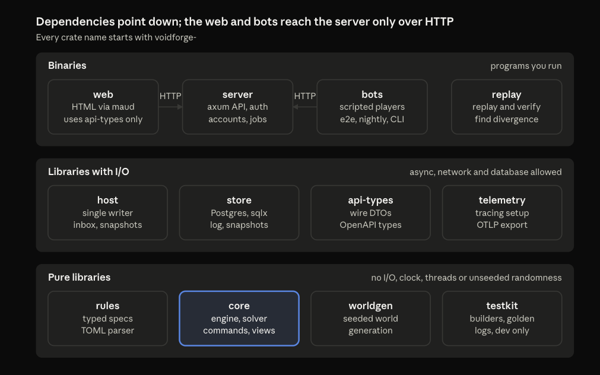
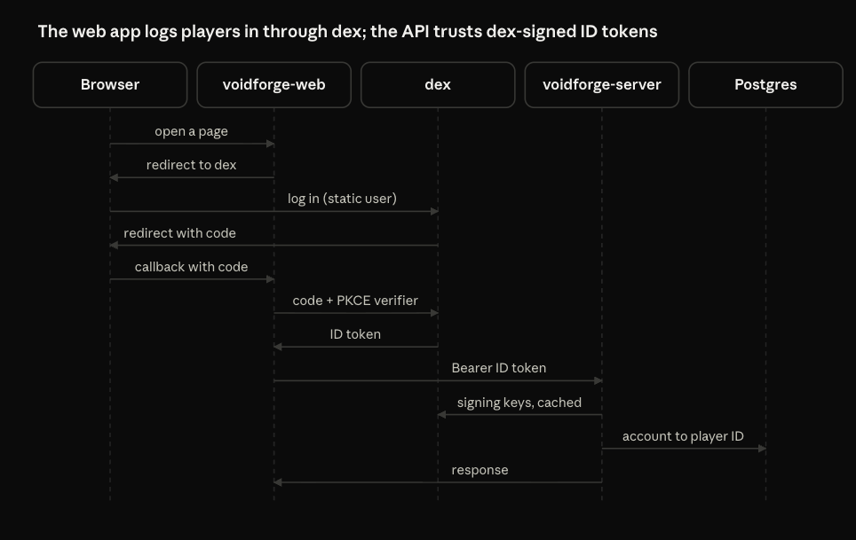
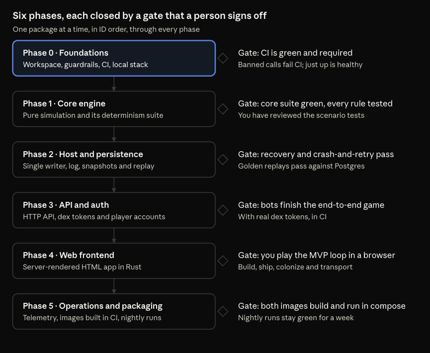

# Voidforge Technical Plan

Oct 14, 2026 · @Tomáš Grbálik

## Overview

This plan turns Voidforge MVP Game Design and Voidforge Architectural Design into six phases of work for a factory of coding agents, on a Rust stack. Every choice in Decisions is agreed, so Phase 0 can start.

It covers the tech stack, the workspace layering, auth through a local dex server, a rudimentary server-rendered web frontend, CI/CD, and the phases with the gate that closes each one. Each phase splits into work packages, each one incremental step for one agent and one pull request; each package names its crate and the tests that prove it done. Packages run strictly one after another, and the team closes every gate itself; the owner is told when a gate closes and is asked only when a decision needs them (see Agent factory rules).

The game design defines the rules and the architectural design defines engine behavior; this plan only decides how and in what order to build them. When the plan and those documents disagree, the documents win, and changes land there first.

Out of scope: the .NET code, which stays in its own repository while Rust starts fresh in a new one, an image registry, CD and any hosted environment for now, and everything the game design lists as post-MVP.

## Decisions

Fourteen choices shape the build, and all of them are agreed. A later change starts here: set its row to Changed, with a comment saying what instead, then update the sections it touches.

| # | Decision | Baseline | Main alternative | Status |
| --- | --- | --- | --- | --- |
| 1 | Repository | A new repository for the Rust workspace; the .NET repository stays as it is | Replace the .NET code in the same repository | Agreed |
| 2 | Runtime and HTTP | tokio with axum | actix-web | Agreed |
| 3 | Database | PostgreSQL through sqlx, with compile-time checked queries and offline query metadata in the repo | diesel or SeaORM | Agreed |
| 4 | Snapshot format | postcard encoding with a BLAKE3 state hash | bincode, or JSON (larger and slower) | Agreed |
| 5 | Rules data | Versioned TOML files in `rules/`, loaded at startup | Constants compiled into the core | Agreed |
| 6 | Identity provider | dex with static users and clients for local runs and CI; real logins later through dex connectors | Keycloak or Zitadel, both heavier to run | Agreed |
| 7 | API credential | The dex ID token as a bearer token, checked against dex's published signing keys | dex access tokens, or opaque tokens with introspection | Agreed |
| 8 | Login flows | Web frontend: authorization code with PKCE, as a confidential client. Bots and CLI: device code. CI tests: password grant for test users only | Client credentials for bots, which needs a dex feature flag and yields tokens with no user | Agreed |
| 9 | Player accounts | A Postgres `accounts` table maps issuer and subject to a player UUIDv7; the first call creates it and issues Join game | Derive the player ID from the subject | Agreed |
| 10 | Web frontend | A separate `voidforge-web` binary rendering HTML with maud: plain forms, no CSS framework, no JavaScript. It calls the public API over HTTP and never links the server or the core | A static page with a little JavaScript | Agreed |
| 11 | Telemetry | tracing with OpenTelemetry over OTLP; locally the all-in-one `grafana/otel-lgtm` container | Jaeger plus Prometheus | Agreed |
| 12 | CI/CD | GitHub Actions; images are built in CI but pushed nowhere; a registry and CD come later | One staging VM running docker compose | Agreed |
| 13 | Test tooling | cargo-nextest, proptest and insta | The built-in runner and quickcheck | Agreed |
| 14 | API description | OpenAPI generated from the types with utoipa, served at `/openapi.json` | A hand-written spec | Agreed |

## Tech stack

Every pick favors widely used, well-documented crates, because agents write most of the code. Phase 0 pins exact versions; upgrades later happen only in dedicated pull requests.

| Concern | Choice | Notes |
| --- | --- | --- |
| Toolchain | Stable Rust, edition 2024, pinned in `rust-toolchain.toml` | One toolchain for local runs, CI and images |
| Async runtime | tokio | Used by the shell crates only, never by the core |
| HTTP server | axum with tower-http (tracing, request IDs, timeouts) | Same stack for the API and the web frontend |
| HTTP client | reqwest | The web frontend and the bots call the API over HTTP |
| Serialization | serde and serde\_json | The wire format is JSON |
| Database | PostgreSQL with sqlx and its migrations | Query metadata is committed, so CI builds without a database |
| Snapshots | postcard with BLAKE3 | Deterministic bytes; the hash goes into the log and traces |
| Rules files | toml | Versioned files in `rules/`, parsed by `voidforge-rules` |
| Seeded randomness | rand\_chacha | World generation only, from the universe seed |
| IDs | uuid (v7) | Player IDs only; every other ID comes from the engine counter |
| Errors | thiserror in libraries, anyhow in binaries | Library errors stay typed for tests |
| Configuration | clap reading environment variables | One config struct per binary |
| Token checks | jsonwebtoken with a cached copy of dex's signing keys | API side |
| OIDC client | openidconnect | Web side: discovery, PKCE and ID token checks |
| HTML | maud | Markup written and checked in Rust at compile time |
| Web sessions | tower-sessions with the in-memory store | Sessions reset on restart, which is fine for testing |
| API description | utoipa | OpenAPI built from the types the server already uses |
| Telemetry | tracing, opentelemetry, opentelemetry-otlp and tracing-opentelemetry | Set up once in `voidforge-telemetry` |
| Tests | cargo-nextest, proptest and insta | Plus scraper for the web smoke tests |
| Supply chain | cargo-deny | Licenses, advisories and a dependency allowlist |
| Task runner | just | One `justfile`: up, test, e2e, replay |
| Images | Multi-stage Docker builds with cargo-chef | Small runtime images running as a non-root user |
| Rate limits | tower\_governor | Per-player request limits on the API |

## Project layering

Twelve crates in three layers keep the deterministic core free of anything that could break a replay. Dependencies only point down, and the web frontend and the bots reach the server over HTTP alone.



Only `voidforge-host` calls the core's state-changing entry points, and only the binaries talk to the outside world. voidforge-web never links the server or the core: its only workspace dependencies are api-types and telemetry, and CI fails if that ever changes.

| Crate | Role | May depend on |
| --- | --- | --- |
| `voidforge-core` | Engine: state, solver, commands, events and views | No workspace crate; serde and thiserror only |
| `voidforge-rules` | Rules files and a pure parser into the core's typed specs | core |
| `voidforge-testkit` | Test builders and golden logs, dev only | core, rules |
| `voidforge-worldgen` | Seeded world generation | core, rules |
| `voidforge-store` | Postgres access, migrations and the snapshot codec | core |
| `voidforge-host` | Engine host: inbox, stamping, log, snapshots, read model | core, store, telemetry |
| `voidforge-api-types` | Wire types and OpenAPI schemas | No workspace crate |
| `voidforge-telemetry` | Tracing and OTLP setup | No workspace crate |
| `voidforge-server` | API, token checks, accounts and the leaderboard job | host, store, rules, worldgen, api-types, telemetry |
| `voidforge-web` | Server-rendered HTML frontend and OIDC login; reaches the server only over HTTP | api-types, telemetry; never core, host, store or server |
| `voidforge-bots` | Scripted players for end-to-end and nightly runs, plus a terminal client with device code login | api-types |
| `voidforge-replay` | Replay and divergence finder | core, rules, store |

Repository layout:

```text
voidforge/
  Cargo.toml            workspace members, shared lints, pinned versions
  rust-toolchain.toml
  justfile
  clippy.toml           banned APIs for core, rules and worldgen
  deny.toml             cargo-deny policy and dependency allowlist
  crates/               one folder per crate, each with an AGENTS.md
  rules/                versioned rules files (TOML)
  docs/                 game design and architectural design, as Markdown
  tests/golden/         recorded logs and their expected hashes
  deploy/               compose file and dex config
  dockerfiles/          server and web images
  .github/workflows/    CI
```

## Auth

dex runs locally as the OpenID Connect provider. The web frontend logs players in through it, and the API accepts the ID tokens it signs. Nothing in the engine knows about auth: the API turns a token into a player UUID before any command reaches the host.



The API never sees a password. It checks the token's signature against dex's published keys, plus its issuer, audience and expiry, then maps issuer and subject to the player; this is the pattern dex documents for backends that consume ID tokens.

- dex config lives in `deploy/dex/`: the built-in local connector with two static test users, static clients and in-memory storage.
- `voidforge-web` is a confidential client using the authorization code flow with PKCE, redirecting to `http://localhost:8081/callback`.
- The ID token stays in the web app's server-side session; the browser only holds a session cookie.
- `voidforge-cli` is a public client for bots and command-line use, logging in with the device code grant.
- CI end-to-end tests use the password grant for the static test users. dex supports it only when a password connector is set, so it is enabled in the CI config alone.
- Client credentials stay off: dex needs a feature flag for them, and the tokens would carry no user to map to a player.
- The API's audience allowlist names exactly these clients; a token issued to anything else gets 401.
- An `accounts` row ties issuer and subject to a player UUIDv7, created on the first authenticated call along with the Join game command. Switching dex to GitHub or Google logins later changes dex config only, not game code.

Sources: [dex OAuth2 configuration](https://dexidp.io/docs/configuration/oauth2/), [Writing apps that use dex](https://dexidp.io/docs/guides/using-dex/), [dex PKCE support](https://github.com/dexidp/dex/issues/2244).

## Web frontend

The frontend exists so people can test and evaluate the game in a browser, nothing more. `voidforge-web` renders plain HTML on the server with maud: tables, forms and links, browser default styles, no JavaScript.

- It is an ordinary API client. It logs the player in through dex, keeps the ID token in its session and calls the public API with it.
- It never touches the server or the core. Its only workspace dependencies are `voidforge-api-types` and `voidforge-telemetry`, and a CI check fails if its dependency tree ever includes core, host, store or server.
- Every form posts to `voidforge-web`, which sends one `POST /commands` and redirects back to the page. Each rendered form carries a fresh idempotency key in a hidden field, so a double submit runs once.
- Values show as of page load, with their hourly rate and the time they next change. A Refresh link reloads the page.
- A rejected command shows its reason code at the top of the page.

| Page | Shows | Actions |
| --- | --- | --- |
| Home | Login link, or the player's score and planets | Log in, log out |
| Planet | Stocks with rate and cap, buildings with status and progress, shipyard queues, roster | Build, cancel construction, demolish, queue ship, cancel ship build, assemble fleet |
| Fleets | The player's fleets with state, cargo and arrival time | Send, recall, disband, trigger unload |
| Universe | Planets within a radius of a chosen point, with their owners | Open a planet |
| Leaderboard | Ranked scores and their as-of time | None |

## Local development

One `docker compose` file runs everything a developer or an agent needs, and `just up` starts it. The Rust binaries run either inside compose or with cargo against the same services.

| Service | Purpose | Local address |
| --- | --- | --- |
| postgres | Log, snapshots and accounts | localhost:5432 |
| dex | OIDC provider with static users and clients | localhost:5556, issuer `http://localhost:5556/dex` |
| otel-lgtm | Collector, traces, metrics and Grafana in one container | Grafana on localhost:3000, OTLP on 4317 and 4318 |
| voidforge-server | Game API | localhost:8080 |
| voidforge-web | Rudimentary server-rendered frontend | localhost:8081 |

`just seed` creates a universe from a fixed seed, and dex ships with two static test users. A fixed seed means every developer and every CI run starts from the same world. Rules v0 is the default; RULES=fast swaps in the fast test variant, where an hour of play takes a second, for end-to-end tests, smoke tests and hand-played gates.

dex's issuer URL must resolve the same way from the browser and from the containers. The baseline publishes dex on localhost and gives the containers a matching host alias, so tokens issued in the browser verify inside compose.

## CI/CD

GitHub Actions runs the same commands as the `justfile`, so any red check reproduces locally with one command. Pull requests must pass every blocking stage. Images are built to prove they build, but nothing is pushed until a registry and CD exist.

| Stage | What runs | When | Blocks merge |
| --- | --- | --- | --- |
| Lint | `cargo fmt --check`; clippy with warnings as errors plus the banned APIs for core, rules and worldgen; the dependency check that keeps `voidforge-web` away from the server and the core | Every PR | Yes |
| Supply chain | cargo-deny: licenses, advisories and the dependency allowlist | Every PR | Yes |
| Unit and property tests | cargo nextest across the workspace | Every PR | Yes |
| Determinism suite | Double run, observation invariance, golden replays and snapshot round trip | Every PR | Yes |
| Database tests | Migrations, store tests and the sqlx metadata check against a Postgres service | Every PR | Yes |
| End-to-end | Compose runs Postgres and dex, CI runs the server and web app as cargo-built binaries beside them, and bots play a scripted game through the API on the fast test rules | Every PR | Yes |
| Images | Build the server and web images; nothing is pushed | Main | No |
| Nightly | Long bot simulation on the fast test rules, crash-and-retry runs and the full golden replay set | Nightly | No; a failure opens an issue |

Once CD exists, rolling back means redeploying the previous image, so migrations only ever add: no destructive change ships in the same release as the code that stops using it.

## Phases at a glance

Six phases run in order, each closed by a gate that the team signs off; inside a phase, packages run one at a time, in ID order.



The diagram predates the change to team-run gates: where it says a person signs off or "you", read the team, as Agent factory rules describes.

Every decision above is agreed, so Phase 0 can start.

## Phase 0: Foundations

An empty but fully guarded workspace, so every later package lands in CI, under the lints and next to a running local stack. Before it starts, the new repository holds both design documents in its docs/ folder as Markdown; from then on those files are the specs the agents follow.

| ID | Package | Area | Done when |
| --- | --- | --- | --- |
| P0.1 | Workspace skeleton in the new repository: every crate as a stub, toolchain pinned, edition 2024, workspace lints, `unsafe` forbidden | repo root | `cargo build` passes, and `cargo nextest run --no-tests=warn` passes with 0 tests; a stub workspace has no tests, so plain `cargo nextest run` exits 4 by design and the package proof records that |
| P0.2 | Agent conventions: root and per-crate `AGENTS.md`, PR template, decision log, version table | repo root | Merged, linked from the README, and every `AGENTS.md` links to the specs |
| P0.3 | CI baseline: lint, supply chain and test stages, with caching | `.github/workflows` | The checks are required on main; the test stage runs plain `cargo nextest run` once the workspace has a real test, and until then may pass `--no-tests=warn` on that command alone, with a comment naming the package that removes it (the first package to add a real test, P1.1 at the latest) |
| P0.4 | Determinism guardrails: clippy bans on clocks, hash-ordered collections, threads, locks, system randomness, UUID generation and float arithmetic in the core, rules and worldgen, plus a dependency check that keeps `voidforge-web` away from the core, host, store and server | `voidforge-core`, voidforge-rules, voidforge-worldgen, `clippy.toml` | A fixture with each banned call, and one with a forbidden dependency, fails CI |
| P0.5 | Local stack: compose with Postgres, dex and otel-lgtm; dex static users and clients; the `justfile` | `deploy/`, `justfile` | `just up` reports every service healthy and dex serves its discovery document |
| P0.6 | Telemetry bootstrap: one init function for tracing and OTLP export, used by every binary | `voidforge-telemetry` | A stub binary's span shows up in local Grafana |

Packages run one at a time, in ID order.

Gate: CI is green and required, the guardrail fixtures fail as expected, `just up` is healthy, and the conventions are merged.

## Phase 1: Core engine

The complete MVP simulation as a pure library, proven deterministic before anything touches a network or a disk.

| ID | Package | Crate | Done when |
| --- | --- | --- | --- |
| P1.1 | Quantities: value, rate, remainder and checkpoint; reading at t; rising and falling crossing times; snapping to a boundary | core | Results match millisecond-by-millisecond stepping on generated cases |
| P1.2 | Rules: typed specs in the core; TOML files and their validation, plus a fast test variant where an hour of play takes a second | core, rules | Placeholder rules (Rules v0 from the game design) load, and invalid files fail with clear errors |
| P1.3 | State model: the World and every entity in ID-ordered maps, the ID counter, serde derives | core, testkit | Testkit builders can create any entity |
| P1.4 | Event queue and `advance_to`: entries ordered by time, kind and entity ID; stale entries skipped | core | Same-instant ordering tests pass |
| P1.5 | Determinism suite: property tests, observation invariance and an in-process double run, which every later package must pass | testkit, core tests | Green on every PR |
| P1.6 | Per-planet solver, part 1: flows with the even split, halted and throttled states, net rates, next crossing and boundary snapping | core | The game design's examples pass (storage full at hour 500, two Refineries getting 5 t/h each), and so does a named test for every flow, even-split, next-event and crossing case listed below the table |
| P1.7 | Per-planet solver, part 2: build progress and completion, demolition end, same-instant cascades and the loop guard | core | A named test passes for every transition, cascade and loop-guard case listed below the table |
| P1.8 | Fleets: distance, travel time, missions, recall and same-moment colonization | core | Every mission outcome, including a failed colonization and the tie, has a test |
| P1.9 | Commands, part 1: Join game and the five planet and shipyard commands (build, cancel construction, demolish, queue ship, cancel ship build), with validation and reason codes | core | Every accept and reject rule for these six commands has a test |
| P1.10 | Commands, part 2: the five fleet commands (assemble, send, recall, disband, trigger unload), with validation and reason codes | core | Every accept and reject rule for these five commands has a test |
| P1.11 | Views and scoring: projections with `valid_until`, and score with partial credit for builds | core | A view at any t before `valid_until` matches an advance to t |
| P1.12 | World generation: planets and homeworld candidates from a seed | worldgen | The same seed always yields the same state hash, and every world generation default below holds |

Together, P1.6 and P1.7 need a named test for each solver case in the architectural design:

- Transitions at one instant: a construction completes when its delivered ingots reach its cost; a ship build completes, joins the roster and starts the next waiting build; a demolition ends and frees its slot; several at once all apply before rates are set.
- Halted and throttled: zero flow counts as halted, and a positive flow below the rated rate as throttled.
- Drill: full rate normally; throttled to the Refineries' intake when ore storage is full; halted only when ore storage is full and nothing draws from it.
- Refinery: rated intake while ore is in stock; a share of the Drills' output when the ore stock is empty; halted when no ore is in stock or arriving; throttled to half the ingot demand when ingot storage is full; halted when ingot storage is full and nothing draws from it.
- Ingot consumers: constructions and ship builds get their full rate while ingots are in stock, and split the Refinery output evenly when the stock is empty; a Shipyard halts with no builds or no ingots.
- Even split: equal demands get equal shares; a consumer needing less than its share passes the rest evenly to the others; integer leftovers go to the lowest IDs, one gram per hour at a time.
- Next event: the earliest of every stock reaching 0 or its cap, every build reaching its cost and every demolition end; nothing is scheduled when nothing moves.
- Crossing: the quantity lands exactly on its boundary, with its remainder reset to 0.
- Cascades: a completed building changes the flows within the same solve; ingot storage filling halts the Refinery, and ore storage then fills and halts the Drill as later crossings.
- Loop guard: a next event that is not strictly after t, or too many transitions at one instant, stops the engine with an error.

P1.12 starts from these world generation defaults, stored as rules data so they can change later:

- 20 planets per expected player: 2,000 planets for 100 players.
- Integer coordinates spread uniformly through a 1,000-unit cube, at least 10 units apart, so neighbors sit about 45 units, or 4 to 5 hours by Colony Ship, from each other.
- Every planet gets the Rules v0 slots and storage caps.
- One homeworld candidate per expected player, each at least 150 units from the others and with at least 5 planets within 100 units, ordered by a seeded shuffle; Join game takes the next free one.
- The universe seed is a 64-bit number recorded in the first snapshot.

Until P1.12 lands, P1.9 tests Join game against homeworld candidates built with testkit.

Packages run one at a time, in ID order. Each one ships with its own tests, and from P1.5 on, every package must keep the determinism suite green.

Gate: the whole core suite is green, every command and mission is covered, the core has no lint exceptions, and QA has reviewed the scenario tests against the game design.

## Phase 2: Host and persistence

The single-writer engine host with a durable log, snapshots and exact recovery.

| ID | Package | Crate | Done when |
| --- | --- | --- | --- |
| P2.1 | Schema and migrations: `log_records`, `snapshots` and `accounts` | store | Migrations apply cleanly to an empty database |
| P2.2 | Snapshot codec: postcard bytes, BLAKE3 hash, a header with rules version and engine build | store | Encode, decode and re-encode give identical bytes |
| P2.3 | Engine host loop: bounded inbox, waking on a command or the next event, stamping, sequence numbers, group commit, reply, read model publish | host | Commands round-trip through both an in-memory test store and Postgres |
| P2.4 | Idempotency: the key-to-outcome map, rebuilt from the log, with a retention window | host | A repeated key returns the first outcome, including after a restart |
| P2.5 | Snapshots and recovery: scheduled and shutdown snapshots; restore, replay the tail, verify events, catch up to now | host, store | Snapshot round trip and recovery tests pass |
| P2.6 | Golden logs: scripted testkit scenarios run through the host and recorded as logs with their state hashes, then blessed with just bless after a reviewer checks them | testkit, host | The first blessed golden logs are in tests/golden/ and replay in CI |
| P2.7 | Replay CLI: replay a log, verify hashes and find the first divergent record | replay | Golden logs replay cleanly, and a tampered log is pinpointed |
| P2.8 | Crash-and-retry harness: kill the host at random points | host tests | Every retried command ends with exactly one outcome |
| P2.9 | Universe bootstrap: a server subcommand that generates a universe from a seed and writes its first snapshot; just seed wraps it | server | On an empty database, just seed always yields the same state hash |

Packages run one at a time, in ID order.

Gate: recovery, crash-and-retry and golden replays all pass against Postgres, and just seed builds the same universe every time.

## Phase 3: API and auth

The public HTTP API from the architectural design, protected by dex tokens and tied to player accounts.

| ID | Package | Crate | Done when |
| --- | --- | --- | --- |
| P3.1 | API types: commands, views and errors, with OpenAPI from utoipa | api-types | `/openapi.json` builds, and the schemas for every command and view validate |
| P3.2 | Token checks: dex ID tokens verified against cached signing keys, issuer, an audience allowlist and expiry | server | Expired, foreign and tampered tokens all get 401 |
| P3.3 | Accounts: issuer and subject map to a player UUIDv7; the first call issues Join game | server, store | A new dex user gets a homeworld exactly once |
| P3.4 | Routes: `POST /commands` and the GET routes; 200, 400, 401, 422 and 503 mapping; views projected to now | server | insta contract snapshots are stable, and /openapi.json covers every route |
| P3.5 | Leaderboard job: rebuilt every 60 seconds from the read model | server | The as-of time advances and the ranks match the scores |
| P3.6 | End-to-end scenario: bots log in through dex, then join, build, race to colonize and transport cargo | bots | Passes in CI against the compose stack within minutes, on the fast test rules |
| P3.7 | Terminal login: the device code flow through dex for the voidforge-cli client, built into voidforge-bots so people and bots can play from a terminal | bots | A device code login yields a token the API accepts |
| P3.8 | Rate limits: a per-player request limit on the API, answered with 429 | server | A burst over the limit gets 429, and the next window succeeds |

Packages run one at a time, in ID order.

Gate: the end-to-end scenario passes in CI with real dex tokens, and QA has tried the API by hand.

## Phase 4: Web frontend

A person can play the whole MVP loop in a browser. Every package lives in `voidforge-web`, which never links the server or the core.

| ID | Package | Done when |
| --- | --- | --- |
| P4.1 | Login: authorization code with PKCE through dex, state and nonce checks, session and logout | A static dex user logs in and out |
| P4.2 | API client: typed calls built on `voidforge-api-types`, forwarding the ID token | API errors show up as messages on the page |
| P4.3 | Pages: home, planet, fleets, universe and leaderboard | Every page renders from live API data |
| P4.4 | Command forms: one per action, a hidden idempotency key, post then redirect | Every MVP action works from the browser |
| P4.5 | Smoke tests: an HTTP client with a cookie jar walks the login and one game loop | Passes in CI against the compose stack within minutes, on the fast test rules |

Packages run one at a time, in ID order.

Gate: on the fast test rules, QA logs in as a static user in a real browser, then build, queue ships, colonize and transport cargo from the browser alone.

## Phase 5: Operations and packaging

Telemetry, container images built in CI and nightly checks. An image registry, CD and a hosted environment come later.

| ID | Package | Area | Done when |
| --- | --- | --- | --- |
| P5.1 | Telemetry: spans from the API through the engine step and log append; metrics for inbox depth, event lag, step and append latency, snapshot age | server, host | Grafana shows a command's full trace and every metric |
| P5.2 | Container images for the server and the web app: multi-stage builds, non-root runtime, built in CI and pushed nowhere | `dockerfiles/`, `.github/workflows` | Both images run under compose and pass the smoke test |
| P5.3 | Nightly runs: a long bot simulation on the fast test rules, crash-and-retry and the full golden replay set | CI | Results are posted, and a failure opens an issue |
| P5.4 | Backup and restore drill: restore Postgres into a fresh stack and check the state hash | ops runbook | The restored hash matches the source |

Packages run one at a time, in ID order, after the Phase 4 gate.

Gate: both images build in CI and run under compose, and the nightly runs stay green for a week.

## Agent factory rules

These rules keep the factory on one package at a time, so every change lands on a green main and never competes with another for the same code.

- One work package is one pull request, and its title starts with the package ID. There is no size limit, but each package must be one increment: it lands on a working main, keeps every existing test green and adds one testable step, never a big-bang drop.
- One package is in flight at a time: the next one starts only after the previous one merges with CI green. P0.1 and P0.2 come before CI exists, so a reviewer checks those two by hand.
- Contracts land first: a package that adds public types or traits merges before the packages that use them.
- The documents are the source of truth. If code and documents disagree, the agent stops and raises a question instead of guessing, and the document changes land before the code.
- Every crate has an `AGENTS.md` with its purpose, allowed dependencies, invariants and test commands.
- Guardrails are mechanical: CI enforces the lints and the dependency allowlist, and a new dependency needs a row in the decision log.
- Zero tests is never a pass by configuration: no repository-wide nextest override such as `NEXTEST_NO_TESTS`, and no placeholder tests to satisfy the runner. The only exception is the command-local `--no-tests=warn` in P0.1 and P0.3, removed as P0.3 states.
- Tests come with the code: unit tests plus the package's "done when" checks, with the determinism suite on every pull request.
- Golden files change only through `just bless`, and a reviewer checks every change to them.
- A reviewer agent checks each pull request against its package row before merge.
- The team closes each phase gate: QA runs the gate's checks and confirms them by effect, both reviewers review the phase's accumulated work independently, and the lead closes the gate once all three agree, then tells the owner.
- The team makes its own decisions, including Decisions-table changes and document clarifications, and records each in the decision log. It reaches the owner only for a change to the game design's intent, for anything that needs new accounts, money or access, or for an action that cannot be undone outside the repository.
